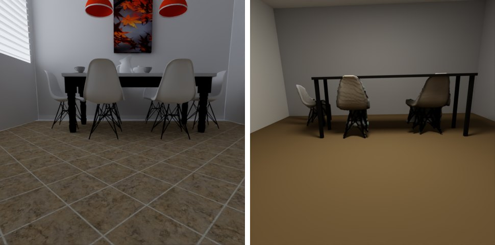

# From a picture to a scene

Four ways to get a real-world picture into a rendered scene, from simple to ambitious. The first three are in the
[Scene Builder](SCENE_BUILDER.md); the fourth is a workflow using free tools, with the renderer at the end of it.

| You have | You want | Use |
|---|---|---|
| any picture | it on a wall, a floor, a ball, a statue | **Pictures** (built in, nothing to install) |
| **one** photo of an object | a 3D version of it to light and render | **Object from a photo** (optional helper, runs on your computer) |
| **one** photo of a room | an editable room: walls, floor, ceiling, windows, and the camera | **Room from a photo** (the same helper) |
| **many** photos of an object or place | an accurate 3D copy | **A photo scan** with COLMAP or Meshroom, then bring the mesh in |

## Pictures

A diffuse or glossy-paint material can be coloured by a picture instead of a flat colour: pick the material's
**Picture** in the Scene Builder's properties (**Clear** goes back to a colour). PNG, JPEG, BMP, TGA, EXR and HDR work.

- On a **quad**, choosing a picture also gives the quad the picture's shape, and the quad is written so the picture is the
  right way up and not mirrored when you stand the quad up as a wall (rotate it 90 degrees about X; it then faces +Z, towards
  the default camera).
- On a **sphere**, the picture wraps around it (its poles are on the Z axis, so with the default camera you look at a pole).
- On a **mesh**, the mesh's own texture coordinates decide where the picture goes. A mesh without them shows one colour.
- The picture is read as an ordinary (sRGB) picture, so what you see is the colour you put in.
- The scene file stores the picture's path. Keep the picture where it is, or choose it again after moving the scene. The Scene Builder warns when a
  picture, mesh or sky file it points to is no longer there (the renderer would otherwise just render without it).
- A phone photo is often stored sideways with a rotation tag that the renderer ignores. When a picture has one, the Scene Builder saves an upright PNG
  copy under its data folder (`pictures\`) and uses that, so the picture is the right way up and a quad takes the right shape.

For a sky, give the **Sky** light an image instead (an equirectangular panorama).

## Object from a photo

**Add > Object from a photo...** turns one photo into a textured 3D mesh and puts it in the scene, standing on the floor and
about two units tall. A model called [TripoSR](https://github.com/VAST-AI-Research/TripoSR) (MIT licence) guesses the
shape. It runs on your own computer; **the photo is not uploaded anywhere**.

It is a guess, not a scan. Expect:

- the front to look right and the **back to be invented**, so check the object from every side before relying on it;
- soft detail: a face, text or thin parts (a chair's slats, a plant) come out smooth or blobby;
- the colour to be baked into the surface, so highlights and shadows in the photo stay in the texture. Light the object
  evenly (soft light, no hard shadows) and it re-lights well; a photo with strong sun on one side keeps that side bright.
- one object per photo, on a plain background if you can. The background is removed automatically (a PNG that already has
  a transparent background is used as it is).

### Setting it up (once)

The helper is **optional**: it needs PyTorch and about 5 GB of disk, so it is not part of the program. From the program's
folder, in PowerShell:

```powershell
powershell -ExecutionPolicy Bypass -File scripts\setup_photo_to_mesh.ps1
```

This needs Python 3.10, 3.11 or 3.12 and git on your PATH. It makes a private Python environment in
`%LOCALAPPDATA%\RayTracerPhoto` (it never touches your other Python installs), installs PyTorch (the NVIDIA build when it
finds an NVIDIA card, otherwise the processor-only build), installs TripoSR at the version this was tested with, and downloads the
model weights (about 1.7 GB, from Hugging Face) and the background-removal model (U2-Net, Apache-2.0, about 176 MB). Then use the menu as above.

An NVIDIA card with about 6 GB of memory makes a photo take seconds; on the processor it takes several minutes. On a Mac see the next section.

**From the program (Windows).** Open the **Diagnostics** tab, press **Run Diagnostics**, and if its *Photo helper* section
lists something missing, press **Install Photo Helper...**. It says what will be downloaded and from where, shows the exact script it will run, asks you to confirm, runs the same
setup script with its output in a window (Cancel stops it and everything it started), and runs the diagnostics again when it is done, so the
report shows the result. It needs Python 3.10 to 3.12 and git on your PATH; on macOS and Linux the button is disabled and the guide's other steps apply.

**Checking what is installed.** Run the **Diagnostics** tab: its last section, *Photo helper*, lists the helper script, the
Python environment, each package with its version (PyTorch, Transformers, rembg, xatlas, scikit-image, SciPy, trimesh, NumPy,
Pillow, einops, OmegaConf, Hugging Face Hub, ONNX Runtime), the graphics card PyTorch can use, the TripoSR code, and whether the two
model files are already downloaded. Anything missing or unusable is flagged (and the setup script is named), so a broken install
shows up there instead of as a failed import halfway through a photo. The same list is printed by
`python tools\photo_to_mesh\photo_to_mesh.py --check`.

If you keep the environment somewhere else, set `RAY_TRACER_PHOTO3D_PYTHON` to its `python.exe` and pass `-Folder` to the
setup script. Keep the folder name short: PyTorch's folders are deep and Windows stops at 260 characters.

### On a Mac

The same helper works on macOS; the installer is a bash script that ships inside the app (`Contents/MacOS/scripts/setup_photo_to_mesh.sh`). The easiest way is the **Diagnostics** tab: *Run Diagnostics*, then *Install Photo Helper* (it asks first, shows the output while it runs, and Cancel stops it and everything it started). Or run it yourself:

```bash
bash "/Applications/RayTracerGUI.app/Contents/MacOS/scripts/setup_photo_to_mesh.sh"
```

It needs **Python 3.10, 3.11 or 3.12** and **git**, which a Mac does not have by default. The Diagnostics tab's **Install Photo Helper** button (or the script) looks for a suitable Python on the usual paths, including Homebrew's and python.org's, which a program started from Finder does not have on its PATH; if there is none it downloads a private copy of Python 3.12 (about 25 MB, from the python-build-standalone releases on GitHub, checked against their published SHA-256) into the same folder, so nothing needs installing first except git (`xcode-select --install`). What it found or skipped is in the installer's window and in the log file. You can also bring your own: `brew install python@3.12`, or the installer from python.org. The environment goes to `~/Library/Application Support/RayTracerPhoto` (set `RAY_TRACER_PHOTO3D_PYTHON` to its `venv/bin/python` if you keep it elsewhere).

- **Apple silicon** uses the Apple GPU through PyTorch's MPS backend; if MPS cannot run something the helper says so and finishes on the processor (several minutes). `PYTORCH_ENABLE_MPS_FALLBACK=1` is set for it.
- **Intel Macs** get PyTorch 2.2.2, the last version built for them, and always run on the processor (several minutes per photo).
- The results folder is `~/Library/Application Support/Ray Tracer Project/Ray Tracer/photo_meshes`.

### Where things go

Each photo's result is kept in the program's per-user data folder, in `photo_meshes\<photo name>-<date and time>\`
(on Windows `%APPDATA%\Ray Tracer Project\Ray Tracer\photo_meshes`), as `mesh.obj` and `texture.png`. A saved scene points at
those files, so keep that folder (or copy the two files and choose them again) if you move the scene to another computer.

The Diagnostics report's *Saved Photo Objects* line says how many of these folders there are and how much space they take. Nothing deletes them
automatically (a saved scene may point into one), so delete the ones no scene uses when you want the space back.

You can also run the helper by itself:

```powershell
%LOCALAPPDATA%\RayTracerPhoto\venv\Scripts\python.exe tools\photo_to_mesh\photo_to_mesh.py photo.jpg --out out_folder
```

`--resolution 384` gives a finer mesh (slower), `--texture-size 2048` a sharper texture, `--no-remove-bg` skips the
background removal for a photo that already has a plain background.

### Taking a good photo

One object, in the middle, filling about two thirds of the picture, shot from slightly above and from the front (three-quarter
views work well), against a plain background, in even soft light. Avoid glass, mirrors and very shiny things (the model sees
the reflections as part of the object), and objects cut off by the edge of the photo.

### If it does not work

| Message or symptom | What to do |
|---|---|
| "The photo helper has not been set up" | Run the setup script above. The Diagnostics tab shows what is missing. |
| "found no object in the photo" | Use a clearer photo of one object on a plain background. |
| runs out of graphics memory | Close other programs that use the GPU, or run the helper by hand with `--device cpu` (slow). |
| the object comes out lying down or upside down | Use the Rotation fields on the object (the model assumes the photo shows it upright). |
| setup fails with a "path too long" error | Pass a shorter `-Folder`. |

## Room from a photo

**Add > Room from a photo...** turns one photo of a room into a room you can edit: its **floor, ceiling and walls** at about the right size and colour, the **windows and
lamps** as lights, a **camera** that sees what the photo saw (so the first picture you render is the photo's view) and, if you ask for it, the **furniture** it recognises. A small depth model ([Depth Anything
V2](https://github.com/DepthAnything/Depth-Anything-V2), "Metric Indoor Small", 25 million parameters) guesses how far away every pixel is, and a geometry step fits a box-shaped room to that.
It runs on your own computer; **the photo is not uploaded anywhere**. The room **replaces the current scene** (Undo brings it back).



*Left: the photo (here a render of a view of the bundled Breakfast Room scene, because its true layout is known). Right: the room the program made from it, rendered from the camera it placed. The floor's tiles and grout, the painting on the wall, the corner and the brightness come from the photo; the table (measured boxes: a top and four legs) and the chairs (3D models of the photo's chairs) stand where the photo has them. The lamps, the window's view and small things do not.*

It is a first draft, not a scan:

- the **furniture is a guess** (the next section): only what the model can name is found, each piece has an invented back, and the room itself is empty of everything else (pictures, rugs, small things: add them with *Object from a photo*, shapes or the model library);
- a wall, floor or ceiling the photo **does not show is assumed** (the program lists those after it finishes), and the room is a plain box, so alcoves and sloping ceilings are lost;
- the **size** is only as good as the depth model's sense of scale: it is usually within a fifth, sometimes further. If you know how high the camera was above the floor, say so in the dialog
  and everything is scaled to match;
- the **surfaces carry the photo's own look**: for every point of the floor, ceiling and each wall the photo shows, the program finds the pixel that sees it and takes its colour, so a wood floor keeps its grain, a tiled one its grout, and wallpaper and the pictures hanging on a wall come with the wall. A point something stands in front of (a chair in front of a wall) is skipped, found by comparing the depth the photo measured with the point's distance, and what the photo does not show or furniture hid is filled in smoothly from what it does, so a hidden patch of floor is a soft blend of its surroundings, not more grain. The colours are brightened like a flat colour would be (a lit photo is not a reflectance, so a dark room's walls are only partly brightened), and what the photo shows only a little of keeps one flat colour. The pictures are in `textures\` beside `room.json`;
- a patch that is clipped to white in the photo (a window, a lamp) becomes an emitting panel on the wall or ceiling, and a window shows what the photo shows there (the panes, the blinds, a view when the exposure kept one: its pixels are cut out as the panel's *Light picture* in the Builder, so it glows in those colours; photo windows are mostly overexposed white, so what you usually gain is the window's structure, not a landscape) it is on, and if the photo has none, one light goes in the middle of the ceiling.
  The **light level** is set by rendering a small draft of the room and turning the lights until its average brightness matches the photo's, so the rendered room is about as bright as the
  photographed one (the first render also shows how far off the colours are: change them in the properties).

### Furniture

The dialog's **Furniture to add** (0 to 8, 4 to start with) is how many pieces to look for. A second small model (DETR, Apache-2.0, about 170 MB, downloaded the first time) outlines and names what is in the photo; the program keeps the chairs, sofas, beds, tables, plants, shelves, cabinets, appliances and a few other things it knows (not people or animals) that cover at least about 1% of the picture, the biggest first, then builds each one. **Tables** are a top the size of the visible top (read from the rays through its pixels, since a top is seen at a grazing angle) on four legs to the floor, and **plain blocks** (a fridge, an oven, a cabinet, a counter, a bed) are one box as wide and tall as the visible side, as deep as the top if it is seen, else a typical depth, and out to the wall if one is just behind: both are measured, with no guessing, and built from Builder boxes (one group, so a table is picked and moved as one). Everything else (chairs, sofas, plants, a TV...) is cut out and the Object-from-a-photo model (TripoSR) makes a 3D mesh of it. Each is stood where the photo shows it: how tall it is and where it stands come from the depth, and it faces the camera (or lines up with the room's walls when it is nearly so, like a sofa against a wall). Its colours are brightened the way the walls are. A piece takes a few seconds on a graphics card and minutes on the processor.

Expect a draft you tidy up: a piece that is **cut off by the picture's edge or half hidden behind another** comes out lumpy or in the wrong place (the model cannot see what is not there); a 3D model's **thin legs and open frames** (a chair's back) come out solid or missing (tables are measured boxes, so theirs do not), and furniture that stands on the floor is put on it whatever its legs showed; and the model only knows common household things (COCO's categories), so a piano or an unusual lamp is left out. Move, resize or delete any piece in the Builder; the notes list what was made. The cut-out each piece was made from is saved next to it as `cutout.png`.

The dialog also asks for the photo's **field of view** (how wide it sees, left to right). Leave it at 0 and the program reads it from the photo's own data (the 35 mm equivalent focal length
that phones and cameras store), or assumes a phone camera's about 67 degrees; a room that looks stretched or squashed in the first picture has the wrong value, and the camera's field of view
in the Camera section fixes it.

### Setting it up

It uses the **same helper environment as Object from a photo** (the setup above: *Diagnostics > Install Photo Helper*; furniture also needs the small `timm` package, which the setup script now installs: if you set the helper up earlier, run the setup script again or `pip install timm` in its environment). The first run downloads the depth model (about 100 MB, from Hugging Face) and says so; furniture downloads its model (about 170 MB) the first time it is asked for. After that it works offline. Unlike the object helper it needs no graphics card: the model is small, a photo takes a few seconds on the processor and about a second on a graphics card.

The depth model is a fine-tune of Depth Anything V2's "Small" model, which is released under the Apache-2.0 licence; the metric fine-tune's own model card does not name a licence, so look at
the [model page](https://huggingface.co/depth-anything/Depth-Anything-V2-Metric-Indoor-Small-hf) before using results commercially. The model is downloaded on your computer and never shipped with the program.

### Taking a good photo

Stand in the room, hold the camera at eye level and level (not tilted much), and show **the floor, the corner where two walls meet, and some ceiling**. Wide views work best (a phone's main
camera is fine). Avoid mirrors and large windows with a bright view (the model reads them as holes in the wall) and very dark rooms. One room per photo.

### Where things go

Each room's result is in the same per-user folder as the photo objects, in `photo_meshes\room-<photo name>-<date and time>\`: `room.json` (the room: its boxes, lights, camera and what was assumed), `textures\` (the pictures of its surfaces) and
`depth.png` (the depth map as a grey picture, white = near, to see what the model saw). The scene itself is an ordinary Builder scene made of boxes: save it like any other.

You can also run the helper by itself:

```powershell
%LOCALAPPDATA%\RayTracerPhoto\venv\Scripts\python.exe tools\photo_to_room\photo_to_room.py photo.jpg --out out_folder [--fov 65] [--camera-height 1.5]
```

### If it does not work

| Message or symptom | What to do |
|---|---|
| "The photo helper has not been set up" | Install the photo helper (Diagnostics tab), as for Object from a photo. |
| "could not find a room in this photo" | Use a photo taken inside a room that shows a floor and at least one wall. |
| "No furniture was recognised in the photo" | Nothing the model knows covered enough of the picture; move closer, or add pieces yourself. |
| a piece is black, lumpy, floating or in the wrong place | It was cut off by the picture's edge, half hidden or thin: delete it and use *Object from a photo* on a clearer picture of it. |
| the room is the wrong size | Say how high the camera was in the dialog (the size follows it), or scale the room's objects in the Builder. |
| the room looks stretched or squashed in the first picture | The photo's field of view was guessed wrong: give it in the dialog, or set the camera's field of view. |
| the walls are crooked | The photo was tilted or showed mostly one wall; try one that shows a corner and some floor. |
| runs out of graphics memory | Close other programs that use the graphics card, or run the helper by hand with `--device cpu`. |

## A photo scan (many photos)

For an accurate copy of a real object or place, take 30 to 100 overlapping photos while moving around it and let
photogrammetry software reconstruct it. Free choices:

- **[COLMAP](https://colmap.github.io/)** (command line and GUI): finds the camera positions and a dense point cloud, then
  *Poisson meshing* gives a mesh.
- **[Meshroom](https://alicevision.org/#meshroom)**: a friendlier interface over the same kind of pipeline, and it can bake
  a texture for you.
- **Apple's Object Capture** (macOS) and phone apps (Polycam, Scaniverse, RealityScan, Luma) do the whole job and export a mesh.

Export a **mesh with a texture** as `.obj` (or `.ply`), then in the Scene Builder:

1. **Add > Mesh...** and choose the file. Set **Scale** until it is the size you want (scans come out in arbitrary units).
2. Set the material's **Picture** to the texture image the scan came with.
3. Add lights and a sky, and render.

Things that do not carry over yet:

- A scan with **several textures or materials** (a mesh made of separate pieces, each with its own picture) shows one picture
  over the whole mesh; use one texture atlas when you export.
- A mesh that has only **per-vertex colours** (no texture) renders in one flat colour. Bake the colours to a texture in
  MeshLab or Blender, or export with a texture.
- Scans are **not relightable** beyond the colour they carry: shadows and highlights from the day they were photographed are
  in the texture. Photograph in even, overcast light to keep that small.

## Why is the furniture only a guess?

One photo does not hold enough information to rebuild a room's furniture: depth is ambiguous and everything hidden is unknown. A room is different, because it is mostly a box: the floor, the
ceiling and a few walls, which a depth map shows well, so *Room from a photo* builds that reliably. Furniture is the same job as *Object from a photo* (one object, one view, an invented back), done several times, with the extra problem that pieces hide one another, so it is offered as a starting point to edit. Neural scene models (NeRF, Gaussian splatting) give beautiful new views of a scene but are not geometry and materials a path tracer can re-light, so they are not offered here.

## For developers

- *Room from a photo* is two Python files that need no model for their tests: `tools/photo_to_room/room_fit.py` (the geometry: depth map to a box room, colours, lights, camera; numpy only) and
  `room_textures.py` (the pictures of the surfaces, read off the photo with the fitted camera) and `photo_to_room.py` (the model wrapper). `python -m unittest tools/photo_to_room/test_room_fit.py` fits rooms of known size photographed analytically (a turned, tilted and rolled camera, noisy
  depth, walls out of view) `test_room_textures.py` (a room painted with "where on the surface am I": the pictures show it where they should, upright, with furniture left out and holes filled) and `test_room_objects.py` (furniture of known size and place: where it stands, how tall, which way it faces, what counts as furniture, the texture's exposure). The Builder's side is `src/shared/scene_room.h` (reads `room.json`, builds the objects, and the light-level solver) with `tests/unit/scene_room_tests.cpp`, which also renders
  a room to check that the photo's left stays left. The GUI self-test mode `room` (`RT_GUI_SELFTEST=room RT_GUI_SELFTEST_ROOM_PHOTO=<image>`) runs the whole flow and writes the room as
  `<prefix>_room.pbrt` (`RT_GUI_SELFTEST_ROOM_FURNITURE=<n>` asks for furniture too).
- The helper's pure parts have tests that need no model: `%LOCALAPPDATA%\RayTracerPhoto\venv\Scripts\python.exe -m unittest tools/photo_to_mesh/test_photo_to_mesh.py`
  (mesh orientation, the colour baker, the `--check` report; they skip without numpy and scipy).
- The Qt-free text handling (`src/shared/photo_helper_report.h`: progress lines, the missing-facts parser, the line splitter that copes with
  `\n`, `\r\n`, PowerShell's `\r\r\n` and pip's lone `\r`) is in `tests/unit/photo_helper_report_tests.cpp`.
- The GUI self-test modes `photo` (needs the helper installed) and `installphoto` (stand-in installer scripts, incl. Cancel; `python3 scripts/gui_selftest.py APP --modes installphoto`) drive the whole flow without dialogs; see
  `qt_gui/mainwindow_selftest_photo.cpp`.
