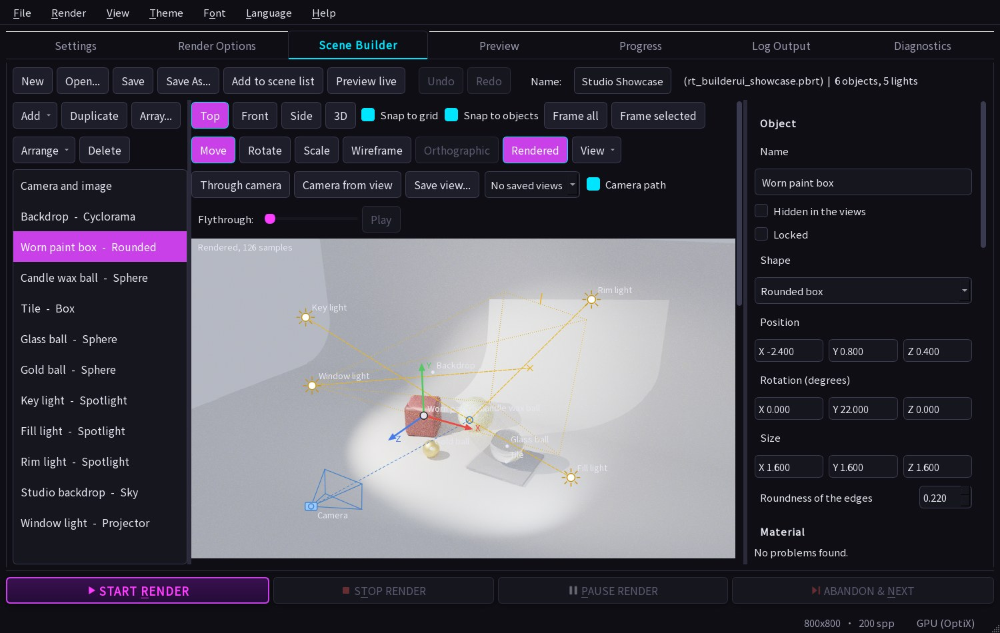

# Scene Builder

Build a scene from shapes, materials and lights, move things around, see a picture, and save it as an ordinary pbrt-v4 file. It is the **Scene Builder** tab of the Qt GUI (`RayTracerGUI`), and it needs no pbrt knowledge.



## A scene to look at first: Studio Showcase

**Studio Showcase** (in the Settings tab under *Materials*, or `pbrt_scenes/studio-showcase.pbrt`, which **Open** loads here for editing) is a small photo studio made with the Builder, to show what it can do together: a **cyclorama** backdrop lit by the **Studio** three-light rig and a **window-pattern projector**; a **rounded box** of red car paint worn through to copper (a **mixed material**); a block of mossy stone (a **ready-made mix**); a candle-wax ball (**subsurface**); a clear glass ball on a tile with a **tiled picture** (texture repeats); and a gold ball. It renders the same on the CPU and OptiX (the means of the two pictures agree to 0.1%). Switch **Rendered** on after opening it to look around it and drag things while it refines. The scene is defined in code, `src/shared/scene_showcase.h`, and `tests/unit/scene_showcase_tests.cpp` checks that the file is exactly what the code writes and that it is a valid Builder scene (`RT_SHOWCASE_OUT=<the file> ray_tracer_tests --gtest_filter=SceneShowcaseTest.WriteTheFile` writes it again after a change).

## Looking at and moving things

1. Open the **Scene Builder** tab. It starts with an example (a checkered floor, glass and gold balls, a red box, a ceiling light and a pale sky).
2. Press **Preview**. A small picture appears in a second or two (Draft quality, on the CPU).
3. Click the gold ball in the layout view and drag it. The properties on the right follow; press **Preview** again.
4. **Add** a shape or a light, pick a colour or a material in the properties, **Preview**.
5. **Save** writes a `.pbrt` file. **Render picture...** renders at the size and sample count set under *Camera and image* and saves a PNG.

The layout view shows the scene from above (**Top**), the front (**Front**) or the side (**Side**). Drag to move, mouse wheel to zoom, right-drag (or drag the background) to pan, **Frame all** to fit everything. Dragging snaps to a 0.25 grid; hold Alt (Option on a Mac) for free movement. The camera has two handles: its position and the point it looks at. Spotlights and the sun have a handle for the point they aim at. Delete removes the selected item, Ctrl+Z / Ctrl+Y undo and redo (also the buttons).

An unsaved scene is kept when you close the program and comes back when you reopen it.

## Looking at and moving things

Above the preview are four views of the scene: **Top**, **Front** and **Side** (flat views, good for exact placement) and **3D**.

In every view a click selects, and dragging an object moves it; the position is snapped to steps of 0.25 unless *Snap to grid* is off or you hold Alt (Option on a Mac).
Each drag is one undo step. In the flat views, the wheel zooms and right-drag (or a drag on the background) pans. In the **3D** view:

| Do this | To |
|---|---|
| Drag the background | Orbit around the scene |
| Right- or middle-drag, or Shift-drag the background | Pan (the Shift-drag is for a trackpad, where a right-drag is awkward) |
| Wheel | Zoom |
| Click an object, light or the camera | Select it (the camera is the little box with its view frame; a spotlight, sun or the camera also has a target you can drag) |
| **Move** tool (W): drag a selected item | Move it on the floor (Shift-drag: up and down) |
| **Move**: drag the white dot in the middle of the selected item, or hold Ctrl (Command on a Mac) while dragging | Move it **freely, in any direction**: it follows the pointer on the plane that faces the camera, so up, down, sideways, nearer or further as the mouse goes. Orbit the view to change which way "sideways" and "nearer" are |
| **Move**: drag the outer half of one of its coloured arrows (X red, Y green, Z blue) | Move it along that axis only |
| **Rotate** tool (E): drag a coloured ring | Turn the object about that world axis (in steps of 5 degrees; Alt or Option for free); the three Rotation numbers are worked out for you |
| **Scale** tool (R): drag a square handle | Stretch the object along that one of its own axes (steps of 5 %): a box's size, a cylinder's or cone's height or radius, a quad's width or depth. A sphere, a disk and a mesh scale all round |
| **Frame all** | Bring everything back into view |

Rotate and Scale apply to the picked object, or to all of several picked items about their middle (see *Picking several things*); for a single light or the camera the Move tool stays.  In the Move tool only the outer part of an arrow takes hold (from about half way to its tip); a press anywhere else on the selected object, the inner part of the arrows included, slides it on the floor, not an arrow (the white dot in the middle is the free move); in the
Scale tool only the square at the end of a handle takes hold (so the scale starts at 1 and does not jump); a ring seen almost edge-on holds still instead of
spinning the object. The Rotate and Scale buttons are greyed while a light or the camera is selected, and Move shows pressed. A new object is dropped on the
floor under the middle of the view, or under what the camera looks at when the camera is nearly level (so it never lands far off-screen). A mesh file is read in
the background: it shows as the small marker until its box and points are ready, and the view does not wait for it. Big flat panels (a wall, a ceiling) are
drawn by their farthest point, so they no longer cover things standing in front of them. Pressing the Move / Rotate / Scale buttons (above the view) or the W / E / R keys
(when the view has focus) switches tool.

The 3D view draws flat-shaded shapes with the same size, position and rotation the renderer uses; it shows shape and placement, not materials or lighting (press
**Preview** for that). A mesh is drawn at its real size: its bounding box (at the object's Scale) with a sample of its vertices, so you can see how big it is and which way it faces; a file that cannot be read, or one over 80 MB, shows a small marker instead.

## Snap to objects

While you drag an object (or several picked ones), **Snap to objects** (the check box beside *Snap to grid*, on by default) lines it up with the objects around it, like the smart guides of a drawing program:

* its **low side, middle or high side** along an axis snaps to the same side or middle of a nearby object (flush edges, centred on each other), and its low side to the other object's high side and the other way round (**resting on top of it, or touching it side to side**); the floor (height 0) is a target for its lowest point;
* only the axes the drag changes snap (dragging on the floor snaps in X and Z; lifting snaps in Y; an arrow snaps along its own axis), within about **8 pixels** of the view you are dragging in, so zooming in makes it finer; the nearest match wins, and a touch wins a tie;
* **orange lines** (through the shared coordinate, in the flat views) and an **outline round the matched object** show what it snapped to, and 3D also says so in the corner; they go when you let go;
* it takes over from the 0.25 grid on the axes where it snaps and leaves the grid alone where nothing is near; hold **Alt (Option on a Mac)** to drag freely without either;
* several picked objects snap as one box (their members are never targets for each other). An object's box is the smallest box round it as it is turned (exact for a sphere, a box, a flat panel and the generated shapes; a mesh file's size is not known to the builder, so a mesh snaps only by its middle point). Lights, the camera and their targets, keys, the numbers in the properties and the arrows' keyboard moves are not snapped.

## The camera as a photographer's lens

Select the camera and its properties give the lens in a photographer's terms as well as in degrees and scene units. The scene file keeps the **field of view** and the **lens radius** (that is what the renderer reads, and what every older scene has); the other rows are worked out from them and edit them, so either way of saying it works and they follow one another.

* **Focal length** (mm) is the lens the field of view means on the chosen **Sensor** (full frame, APS-C, Micro Four Thirds, Super 35 film, medium format, IMAX 70 mm film, 1 inch, a phone, or **Sensor width** typed in). The picture uses the whole width of the sensor and its height follows the picture's shape, so a 16:9 picture is shorter than a 3:2 one and the lens sees less up and down, as a real camera crops. 50 mm on full frame is about 40 degrees across, 24 mm about 74, 135 mm about 15. Typing a focal length sets the field of view; choosing a different sensor keeps the view and changes the focal length it means.
* **Lens** picks one of eight usual focal lengths (14 mm ultra wide to 400 mm super telephoto) in one step.
* **Aperture (f-number)** sets the **lens radius** for a scene where one unit is a metre: the radius is the focal length over twice the f-number (50 mm at f/1.8 is 0.014). "Pinhole" is a lens radius of 0 (everything sharp). A lens radius above 0 blurs what is not at the **Focus distance** (depth of field), more for a wider opening and a longer lens. If your scene is in other units, set the **Lens radius** directly.
* **Pick focus in the 3D view** then a click on whatever should be sharp puts it in focus: the focus distance becomes how far that point is from the camera along the way the camera looks (the focal plane is flat, not a sphere round the camera). The click takes the view's nearest surface under it (or the floor); Escape cancels. With the camera selected and a lens radius above 0, the 3D view draws the **focal plane** as a green dashed rectangle with a cross in the middle: what is on it is sharp.

The sensor width is kept in the builder's copy of the scene and with each saved view (the `.pbrt` has only the field of view and the lens), so a saved 24 mm view comes back as 24 mm.

## Camera views

The scene has one camera (select **Camera and image** in the list to edit it), and the 3D view has a row of camera buttons under its tools:

| Button | Does |
|---|---|
| **Through camera** | The 3D view takes the camera's place, direction and field of view, with the picture's frame drawn over it (what is outside the frame is dimmed), so you see what a render will frame. It follows the camera while you edit its numbers or drag it. Orbiting, panning, zooming or Frame all leaves it, and the view stays where it is |
| **Camera from view** | Puts the scene's camera where the 3D view is now, looking the same way. The lens (field of view, lens radius) stays; the focus distance follows what the camera looks at unless the lens radius is above 0 (you set that focus on purpose). One undo step |
| **Save view...** | Asks for a name and remembers what you are looking at now (the 3D view's place, or the camera while looking through it) as a saved view |
| the **Saved views** list | Pick a view to put the camera there; the 3D view then looks through it, so you see the change |

The camera's properties also list the saved views, each with its name (edit it to rename), a **Hold** time in seconds (how long a flythrough stays there; see *Rendering*) and **Use**, **Update** (save the camera as it is now over that view) and **Delete**, and a **Save camera as a view** button. A view is a whole camera (position, what it looks at, field of view, lens radius, focus distance); names are made unique ("Front", "Front 2"), there can be 100, and each of these is one undo step. Views are kept in the scene's JSON copy, so reopening the file brings them back; the `.pbrt` text has only the scene's one camera. Looking through the camera uses the world's up direction, so a camera with a tilted up vector shows level.

With two or more saved views the bar also gains the **Camera path** tick, the **Flythrough** slider and **Play** (they are hidden until then), and the 3D view draws the **flythrough path**: the smooth orange curve the camera would follow through them, in the order they were saved, with a marker and the name at each view (the first one filled) and a short dotted line along where it looks. It is the same curve the Flythrough video uses, so what you see is what is rendered; edit a view (**Update**) and the curve follows. The **Camera path** switch next to the saved-views list hides it, and it is not drawn while you look through the camera.

**Drag a marker** to move that saved view: its eye slides on the floor plane (in steps of 0.25; hold Shift to lift it, Ctrl to move it freely, Alt to ignore the grid). Pressing a marker also shows where that view looks, with a ring at its target that you can drag the same way. The lens, field of view and hold are kept, the focus distance follows what is looked at (unless the lens has depth of field), and one drag is one undo step; the selection does not change.

The **Flythrough** slider beside it scrubs the 3D view along that path: at the left end it looks from the first saved view, at the right end from the last, and in between from where the flythrough video's camera would be (the same pace, easing and pauses, with the pauses measured against a nominal 10-second video), with each view's own field of view and lens, and the picture's frame drawn over it. Nothing in the scene changes; orbit, pan or zoom to leave (the slider goes back to the start). While it is on, **Camera from view** and **Save view** take the point you are looking from, so a view can be saved from anywhere on the path. **Play** beside the slider runs it by itself, taking 10 seconds for the whole path (the nominal video length the pauses are measured against); click again to pause, and it stops at the last view (Play again starts over). Moving the slider, orbiting, panning or zooming stops it. It needs two or more saved views.

## Ready-made shapes

Besides the sphere, box, quad, disk, cylinder, cone and mesh file, the Add menu has shapes with no pbrt primitive of their own. They are written into the scene as triangle meshes with smooth or sharp normals as fits the shape, so they render the same on the CPU, Metal and OptiX.

| Shape | Settings | Notes |
|---|---|---|
| Pyramid | base width (X), base depth (Z), height | four sloping sides, apex above the middle |
| Wedge (ramp) | size X, Y, Z | a box cut along its diagonal: low at the front (-Z), full height at the back |
| Stairs | size X, Y, Z, steps (1 to 100) | climbs from the front (-Z) to the back |
| Torus (ring) | ring radius, tube radius | lies flat; the tube must be thinner than the ring radius |
| Capsule | radius, height | a cylinder with rounded ends; the height includes the ends (never less than twice the radius) |
| Dome (half sphere) | radius | flat bottom, `radius` tall |
| Tube (pipe) | outer radius, hole radius, height | a hollow cylinder, open at both ends |
| Rounded box | size X, Y, Z, roundness of the edges | a box whose edges are quarter cylinders and corners eighth spheres, with exact smooth normals; roundness 0 is a plain box, and it is clamped to half the smallest side (a round ball) |
| Cyclorama (studio backdrop) | size (width, height, depth), radius of the curve | the seamless backdrop of a photo studio: a floor that curves up into a back wall; a single sheet (front edge of the floor at +Z, wall at -Z) facing into the room, so put the subject on its floor and the camera in front. Pairs with the Studio and Light box lightings |
| Terrain (rolling ground) | size (width, hill height, depth), detail (grid cells across, 2 to 128), hills across, roughness (0 to 1), seed | ground from smooth noise: `hills across` is how many hills the biggest features have across it, `roughness` adds smaller lumps on top, and the **seed** picks which ground; the same numbers make exactly the same ground on every machine (the noise is made from integer hashing). The hills fill the height, centred on the object's box (the highest reach half the height above its position) |
| Text (3D letters) | the text (several lines, any language the font has), font, bold, italic, how lines line up (left, centre, right), height of a capital letter, thickness, stretch sideways | letters pulled out into a solid, standing up and facing the default camera (+Z): the front reads left to right along +X. The outlines come from the font you pick (the computer's own list; "Default font" is the application's), are cut into triangles (holes in an O, B, 8 and islands inside holes are handled by the winding of the outlines, as a font fills them) and written into the scene file as a mesh, so the file shows the same words on a computer without that font. Corners stay sharp and curves are shaded smoothly. Centred on its position (the box round all the letters), so a two-line text is centred on both lines. A text is at most 400 characters. `src/shared/scene_text.h` makes the mesh and `tests/unit/scene_text_tests.cpp` checks it: the faces add up to the area the outlines enclose, and the solid's volume (by the divergence theorem, which also proves every triangle faces outward) is area times thickness |

Each one has a picture-friendly set of texture coordinates, so the checker pattern and a picture work on them (and their repeats and shift, see Texture placement under Materials). The meshes are `scene_shapes.h`; `tests/unit/scene_more_shapes_tests.cpp` checks the rounded box's and the cyclorama's surface area against closed forms (the rounded box's is `2[(a-2r)(b-2r)+(b-2r)(c-2r)+(a-2r)(c-2r)] + 2*pi*r*(a+b+c-6r) + 4*pi*r^2`), that every triangle faces the way its normals do, that the terrain is the same every time and different for another seed, and that all three are written, saved, checked, scaled and read by the renderer's loader like the others.

## Picking several things

Like Blender's selection, the Builder can act on several objects and lights at once.

| Do this | To |
|---|---|
| Ctrl- or Shift-click a row of the list (Command on a Mac for Ctrl) | Add rows to the pick or take them out; Shift-click picks a run of rows |
| Ctrl- or Shift-click an object or light in a view (3D: a click without dragging; Shift-drag still lifts and Ctrl-drag still moves freely) | Add it to what is picked, or take it out |
| Ctrl- or Shift-drag from anywhere in a flat view (the floor included) | A box: everything whose centre is inside is added to the pick |
| Ctrl+A | Pick every object and light (not the sky, which has nowhere to be moved to) |
| Drag one of the picked items in a flat view, or one of the 3D arrows | All of them move by the same amount (one undo step) |
| A plain click on one of several picked items | Leave just that one picked |

While several are picked the properties panel shows who they are and offers **Move all by** (exact X, Y, Z, in scene units), **Turn all by** and **Scale all to** (below), **Group** / **Ungroup**, and **Use <main object>'s look for all**, which gives the other picked objects the main one's material and light settings (the main one is the first you picked, and is the one the Array window starts from).

**Turning and scaling several as one.** The 3D view's tool is drawn at the middle of the picked items (the mean of their positions), and the Rotate and Scale tools work on all of them about that point:

* **Rotate** (E): drag a ring to turn the whole set about that world axis (steps of 5 degrees; Alt or Option for free). Every position goes round the middle and every object turns by the same amount about the same world axis, so the set keeps its shape; a spot's or sun's target goes round too. **Turn all by** does it with exact numbers, X then Y then Z, in degrees.
* **Scale** (R): drag a square handle on a world axis to stretch the whole set uniformly about the middle (steps of 5 %): positions move along the lines from the middle, and every object grows or shrinks by the same factor in all directions (a mesh's scale included; a light's brightness is left alone). **Scale all to** does it with a percentage (100 % is no change, 200 % twice the size), from 1 % to 10,000 %.
* The middle stays where it is while you turn or scale. Each drag is one undo step, and every update is worked out from the items as they were when the drag began, so a long drag does not drift. The Move tool's arrows are drawn at the middle too. With one thing picked, Rotate and Scale are as before (that object's own axes). **Duplicate** copies everything picked, each copy keeping its place relative to the others and moved sideways together by about the width of the whole (so a copied table does not land inside the table); **Delete** removes everything picked; **Array...** copies the picked objects as one unit (the main one is the anchor). Each is one undo step, and undo keeps what was picked.

**Groups.** *Group* (Ctrl+G) turns two or more picked objects into a group: clicking any member in a view picks the whole group, so a table's top and four legs are one thing to move, copy and delete. The props in the Add menu (table, chair, tree...) and the blocky things arrive as groups already. A copy of a group, by Duplicate or by an Array of it, is a group of its own ("Table", "Table 2"...). The list still shows every member as its own row, so one leg can still be picked and edited alone (click its row), and *Ungroup* (Ctrl+Shift+G) dissolves the group. A group is only a name on each member (saved in the scene's JSON copy, so reopening the file brings it back); the `.pbrt` text has no groups, so the renderers and Live Preview see the members as the separate objects they are, and an object's name says nothing about its group. A group left with one member (the rest deleted or regrouped) stops being a group.

## Keyboard

**Arrow keys** (when a view has the focus: click in it) nudge what is picked, or the selected camera (with its target, so it keeps looking the same way): a step of 0.25 (the grid), **Shift** a whole unit, **Ctrl** (Command on a Mac) a fine 0.05; **Page Up** and **Page Down** lift and lower it. In the top view Right and Left move along X and Up and Down move away from or towards you (Z); in the front and side views Up and Down are up and down, and in the side view Right is towards the left of the screen's Z axis; in **3D** the arrows follow the screen: Right moves along the horizontal world axis (X or Z) nearest the screen's right, Up along the other one, away from you, so from any side Up goes the way you are looking. A run of key presses (a key held down) is one undo step, and the keys do not snap to objects. The list keeps the arrow keys for moving between its rows.

Delete or Backspace removes what is picked (from the list or a view; in a text box they edit the text). Ctrl+D (Command+D on a Mac) duplicates it, Ctrl+A picks everything, Ctrl+G groups and Ctrl+Shift+G ungroups. Undo and Redo use the platform's usual keys (Ctrl+Z / Ctrl+Y on Windows, Command+Z / Shift+Command+Z on a Mac); the buttons' tooltips show the ones for your keyboard. W, E and R pick the 3D view's Move, Rotate and Scale tools. H hides, Alt+H shows everything hidden, L locks, Alt+L unlocks everything, End drops to the floor, F frames what is picked and F2 renames (see *Arranging*).

## Search for an action

**F3** (or **Ctrl+K**, Command+K on a Mac, where F3 belongs to the system; also **Arrange > Search actions...**) opens a box where you type what you want to do and run it without finding its button: "wire", "drop", "add fog", "top view", "lock". Every word you type has to be somewhere in the action's name, in any order; names that start with your first word come first. Up and Down move the highlight, Enter (or a double-click) runs it, Escape closes. It lists about a hundred actions, each named with its kind: **Lighting** (the six ready-made lightings below), **Add** (every shape, volume, light, prop and blocky object, the model library and a photo), **Edit** (duplicate, array, delete, select all, group, ungroup, undo, redo), **Arrange** (rename, drop to floor, frame selected, hide, show, lock, unlock), **View** (frame all, the six standard views, wireframe, orthographic, through camera, camera from view, snap to objects) and **Render** (the turntable and flythrough videos). The matching is `src/shared/action_search.h`.

## The 3D view: standard views, orthographic, wireframe

Beside the Move, Rotate and Scale tools the 3D view has three more controls:

* **View** puts the camera on an axis, looking at the same target from the same distance: **Front** (from +Z, the way the starting camera looks), **Back**, **Right** (from +X), **Left**, **Top** (from above, with away from you up the screen) and **Bottom**. The name is drawn in the corner until you turn the view by hand.
* **Orthographic** removes the perspective: things keep their size however far away they are and parallel lines stay parallel, which is what you want to line things up or measure by eye (a front view in perspective makes the far things small). It is the same size at the target, so switching does not zoom. Dragging and picking work the same way.
* **Wireframe** draws only the edges of everything, so things show through each other and you can see what is inside or behind (a hidden-line view; there is no shading).

The **numpad** does these when the 3D view has the focus (click in it): **1** Front, **3** Right, **7** Top, and with **Ctrl** the opposite side (Back, Left, Bottom); **5** switches between perspective and orthographic; **0** looks through the scene's camera; **2, 4, 6, 8** turn the view by 15 degrees; **+** and **-** zoom; **.** frames what is picked. (A keyboard without a numpad has the View menu and the buttons.)

## The rendered viewport

The **Rendered** switch (next to Orthographic and Wireframe, shown when the program has the GPU renderer that Live Preview uses) turns the 3D view into a picture of the scene as it will look: a progressive path-traced render, drawn behind the usual names, lights, camera and tool, so orbiting, picking and moving work as they always did with the real picture under them. The corner says how many samples it has ("Rendered, 40 samples"); it starts grainy and refines while you look, and the denoiser cleans it up where it is available.

* **It follows you.** Orbiting, panning and zooming pass the new eye to the renderer without starting over. **Moving things** (dragging in the views, the arrow keys, typing a position) does not start over: the renderer is told how far each object is from where its copy of the scene has it and redraws at once, as Live Preview's Move objects does. Any other edit (a colour, a light, adding or deleting something, turning or scaling) restarts the render once you have paused for about a third of a second; the old picture stays until the new one has samples. Cones, meshes and fog, smoke or clouds restart even when only moved (a cone and a mesh may not be objects the renderer can move, and a cloud's medium stays where it was declared). Things that do not change the picture (a rename, hiding or locking, the saved camera views, the render settings) do not restart it (`scene_viewport.h` decides this by comparing the scene text without those).
* **What it shows.** The 3D view's own camera and field of view, at most 800 pixels wide and drawn scaled up (the same shape as the view). Depth of field is drawn only when you look through the scene's camera (the 0 key), since that is the picture a render makes. Pressing Through camera, or changing the camera's f-number or focus distance while looking through it, restarts the render with the new lens. With Wireframe on the edges are drawn over the picture.
* **It shares the GPU.** It uses the "(live preview)" copy that Preview live writes, and only one of the two can have the renderer at a time: starting the Rendered viewport stops a running Live Preview, and starting Live Preview switches the viewport off. It rests while another tab is showing. The viewport is perspective only, so switching it on turns Orthographic off and leaves the Orthographic button (and the numpad 5 key) unavailable until it is switched off again.
* **What it is not.** It is a quick look, at most 8 bounces and one sample at a time, not a final render; use Render for that. On a Mac it uses Metal, which has not been tried from the Windows side.

## Arranging: hide, lock, drop to floor, frame, rename

The **Arrange** button under the list (and a right-click on an item in the list) has the tidying tools; each is one undo step and works on everything picked.

* **Hide in the views** (H) takes the picked items out of the layout and 3D views, so what is behind them can be seen and edited (lift the ceiling off a room). A hidden item is **still in the scene and still renders**: hiding is for the views only. It shows in the list dimmed with ", hidden", and **Show everything hidden** (Alt+H) brings them all back. The properties of an object or light have a **Hidden in the views** box too.
* **Lock** (L) keeps the picked items from being picked or moved by clicking and dragging in the views, and the arrow keys and the rings and handles leave them alone (so a finished floor or backdrop is not dragged by accident). A click where a locked object is picks what is behind it; a locked item is drawn with a dashed outline in the layout view, and it can still be picked in the list and edited in the properties. **Unlock everything locked** is Alt+L; the properties have a **Locked** box.
* **Drop to floor** (End) puts the picked items down on the floor: all of them together, by the gap under the lowest one, so a table and its legs, or a set picked together, keep their places relative to one another. A mesh file's size is not known to the scene, so a mesh does not count in finding the lowest point (it comes down with the rest).
* **Frame selected** (F in a view, or the button beside Frame all) zooms both views to what is picked (the camera and its target, if that is selected); the 3D view keeps its angle.
* **Rename...** (F2, or double-click an item in the list) asks for a new name; one that is already taken gets a number.

Hidden and locked are saved in the builder's own copy of the scene (the `.pbrt` text, which the renderers read, does not have them).

## Copies: duplicate, array and scatter

**Duplicate** (the button under the scene list, or Ctrl+D / Command+D) makes a numbered copy of what is picked ("Chair" gives "Chair 2") beside the original, moved by about its own width, and picks the copy. One undo step. With several things picked (or a group), all of them are copied together (see *Picking several things*).

**Array...** (select an object first) makes many copies of it at once, in the spirit of Blender's Array modifier and particle scatter. It opens a window with three pages and a line that says how many objects the settings would add:

| Page | Makes | Settings |
|---|---|---|
| **Grid** | a line, a rectangle or a block of copies | how many along X, Y (up) and Z (the original is one of them), and the distance between neighbours |
| **Ring** | copies spaced evenly round a point on the floor, as chairs round a table | how many in the whole ring (the original counts as one and stays where it is), radius, centre X and Z, a turn of the whole ring, and whether each copy turns round with the ring so it faces the centre the way the original does |
| **Scatter** | copies placed at random in a disk or a rectangle | how many, the area (centre, width, depth), the floor height, the smallest and largest size (as a percentage), a random turn about the vertical, a random lean, whether footprints may overlap (and an extra gap), and an **Arrangement** number: the same number always gives the same scatter, **Another arrangement** tries the next |

By default an array copies the one object. To copy a thing made of several objects (a tree's trunk and crown, a table's top and legs, a prop or a blocky creature) either pick them all first (the other picked objects are then ticked, and the main one is the anchor), or tick **Copy other objects together with it** and tick its parts in the list: for one picked object the window ticks the other members of its group, and the objects with the same first word in their name that stand close by, and you can change that. When the parts were one group, each copy is a group too. Each copy keeps the parts' places relative to the selected object (the one you picked is the anchor); a ring turns the whole thing, and a scatter scales and turns it as one, standing it on the floor height you set.

The copies are ordinary objects with their own numbered names: move, recolour or delete them one by one. The whole array is one undo step, and the original is never changed. One array makes at most 500 copies and 2,000 objects in all (fifty copies of a forty-block creature, say); the window says when it has cut it short, and, for a scatter that keeps copies apart, when the area is too small for them all. The turn about the vertical adds to the object's own turn, so it suits upright objects. The numbers come from a small generator written into the program, so a scatter looks the same on every platform and in every build.

**Instances.** Copies stay separate objects in the document (a few hundred bytes of the builder's own data each, which is why the limit exists), but in the scene text the renderers read, copies of a *heavy* shape are written once and placed: pbrt's `ObjectBegin` / `ObjectInstance`. A forest of a hundred pines is one cone mesh and a hundred transforms, not a hundred cone meshes of 700 triangles; the file, the load and the memory on the CPU and the GPU shrink accordingly.

* It is worked out when the scene is written, from the objects themselves: two objects are copies when they are the same shape with the same material and every length of one is the other's times one factor (what Array and Scatter do), wherever they stand and however they are turned. Recolour or reshape one and it simply stops being a copy and is written on its own; nothing to switch on, and nothing in the document remembers it.
* The shapes worth it are the ones written as big triangle meshes: **cone, torus, capsule, dome, tube, rounded box, terrain** and a **mesh file**. A sphere, disk, cylinder, box, quad, pyramid, wedge or stairs is a few lines of text, so it is written as it always was. An emitter (pbrt does not allow an area light in an instance), a volume and a marble or noise pattern (a texture of the position in space) are never instanced; a height map is shared only by copies of the same size (its relief does not scale with the instance).
* It changes nothing in the picture: the same scene written both ways renders alike on the CPU and both OptiX backends (`SceneInstancingTest`, and the instanced scenes of `scripts/combo_sweep.py`). Moving things in the Rendered viewport works on a copy as on any object.

## Volumes: fog, smoke and clouds

**Add > Volumes** puts in a sphere of participating medium: **Fog**, **Smoke** or a **Cloud**. It is not a surface: light passes into it and is scattered or absorbed on the way, so it shows as a soft glow, a dark haze or a lumpy white puff. In the layout and 3D views it is drawn see-through (white-ish for fog, grey for smoke, pale for a cloud) so what is behind it shows.

| Type | What it is | Settings |
|---|---|---|
| Fog | an even haze in a sphere (or a cylinder: pick the shape) | **Density** (how quickly light is scattered or absorbed per unit of distance: 0.3 is a light mist in a sphere a few units across, 2 is thick), **Colour** (the fraction scattered, per colour: white only scatters, so it glows; a tint tints what it scatters), **Forward scattering** (0 scatters evenly, above 0 towards where the light was going) |
| Smoke | the same, starting dark | the same, starting at a dark grey colour, which absorbs most of what it takes from the light |
| Cloud | a lumpy cloud inside a sphere | **Density** (6 is a solid white puff, 1 a thin haze), **Forward scattering**, **Wispiness** (how torn its edges are), **Detail** (lumps across); a cloud only scatters and has no colour |

A volume has no material, picture or light of its own, and **Gives off light** does not apply to it. It is saved as pbrt `MakeNamedMedium` with a `MediumInterface` on a sphere (or cylinder, for fog and smoke), so it renders the same on the CPU, both OptiX backends and the Mac. The medium fills the sphere, not a box: a cloud's density is declared in a cube round the sphere and cut by it. Rotating a cloud turns its lumps; a sphere of fog looks the same turned.

Things to know: a volume shows only where light reaches it, so a scene lit by a small lamp makes fog glow near it; a bigger sphere with the same density is thicker (light crosses more of it); and a scene with many dense volumes takes longer to render and shows more noise at low sample counts.

## Props

The **Props** section of the Add menu puts a few ordinary objects in at once: a **table** (top and four legs), a **chair**, a **tree** (trunk and two cones), a **snowman**, a stone **column** and a **street lamp** (its bulb is an emitting sphere). They stand on the floor with the middle of their footprint where the new item would drop, as one undo step, and are all picked and made a group (the prop's name, "Table"), so they move, copy and delete as one thing; click a part's row in the list to edit it alone, or Ungroup. A second copy of a prop is named apart ("Table top 2", group "Table 2").

## Blocky objects

The **Blocky** part of the Add menu has three submenus of colourful block-style objects (in the look of block-building games; not affiliated with any of them): **Blocks** (grass, dirt, stone, planks, log, sand, glass, water, TNT, gold, diamond ore, a glowing block, lava, a pumpkin and a lantern pumpkin), **Creatures** (a green monster, a pig, a sheep, an explorer, a skeleton) and **Things** (an oak tree, a cottage, a torch, a chest, a crafting table, a furnace, a bed, two flowers, a fence, a row of rainbow-coloured wool, a glowing purple portal). A block is half a scene unit across, so a creature stands about 0.8 tall and the cottage about 4.

Each one goes in as a few dozen ordinary **Box** objects (a creature's body, legs, head and face are separate boxes; the pieces are merged so none overlap), standing on the floor under the middle of the view, as one undo step. From then on they are plain boxes: recolour a creeper's face, delete a window, move one wall. Glass and water blocks use the glass and see-through materials, gold is metal, and the glowing block, lava, torches, the portal, the lantern pumpkin and the furnace fire are light-giving boxes, so they light what is near them.

## Model library

**Add > Model library...** opens a window of ready-made meshes with a picture of each (the Stanford bunny, armadillo, Lucy and dragon, a horse, a cow, a teapot, busts, a beetle car and more: 22 in a source checkout, about 100 thousand triangles each for the big ones). Pick one and press **Add** (or double-click it): it stands on the floor under the middle of the view, about 1.6 units across, as one undo step; **Scale** in its properties resizes it and the Rotate tool turns it. The search box narrows the list by name. **Choose another file...** adds any `.obj` or `.ply` of your own instead (that one keeps its own size, so a big scan may need a smaller Scale).

The installers carry only Spot, Suzanne and the Utah teapot; the rest need a source checkout. Each model keeps the licence of its source: [MODELS.md](MODELS.md) says where each comes from and what to check before publishing.

## What the world looks like

* **+Y is up.** Units are whatever you like; the example is a few units across.
* **Rotation** is three angles in degrees, about the world X, Y and Z axes, applied in that order.
* A **sphere** is centred on its position. A **box**, **cylinder**, **cone** and the ready-made shapes below are centred on their bounding box. A **quad** is a flat rectangle in the XZ plane, a **disk** is a flat circle; a cylinder and a cone stand along +Y.
* A shape that **gives off light** lights its outer side: a box, sphere, cylinder, cone or any ready-made shape outward, a quad or disk from the side facing up. To hang a light panel from a ceiling, rotate it 180 degrees about X (the *Light panel* in the Add menu already is). Tick *Both sides* to light both.
* **Colours** are picked as ordinary (sRGB) colours and stored as linear values for the renderer. A light's *Strength* multiplies its colour, so a white panel of strength 12 has a radiance of 12.

## Sun & sky

Tick **Sun & sky** in a sky light's properties for a clear outdoor sky at a chosen time of day: **Preset** (Sunrise, Morning, Noon, Afternoon, Sunset) or **Sun height** and **Sun direction**, **Haze** (1.7 very clear, 3 ordinary, 6 and up hazy) and **Ground brightness**. Direction 0 is towards +X, 90 away from the starting camera, 180 towards -X, 270 behind it. **Sky gallery...** (under Preset) opens a window of 12 thumbnails of ready-made skies (Sunrise, Morning, Noon clear and hazy, Afternoon, Golden hour, Sunset, Low sun hazy, Heavy haze, Snow field, Dark ground, Desert), each a view of that sky from the ground toward the sun; choosing one sets the sun's height, the haze and the ground brightness and keeps the direction. The skies are made by the program's own Hosek sky model (nothing is downloaded or bundled), the table is `scene_sky.h`'s `presets()`, and `RT_SKY_GALLERY_OUT=<file.ppm> ray_tracer_tests --gtest_filter=SceneSkyGalleryTest.ContactSheetForLooking` writes a contact sheet of them.

What it makes: the sky is the Hosek-Wilkie analytic sky model (the one Blender's Cycles offers; `src/shared/hosek_sky.h`) written as a 512 x 256 equirectangular HDR picture, `sky_v1_e<height>_a<direction>_t<haze>_g<ground>.hdr`, in the `skies` folder beside your My Scenes (`~/Library/Application Support/Ray Tracer Project/Ray Tracer/user_assets/skies` on a Mac); below the horizon the picture is the ground, its brightness times the light that falls on level ground. The scene's **Sun** (the first Distant light, or a new one named "Sun") is aimed along the sun with its colour and strength from the atmosphere the light crosses (Rayleigh and aerosol extinction): a sun on the horizon is dim and deep orange, a high one nearly white. Both are ordinary lights in the saved `.pbrt` (the picture is referenced by its full path, like any picture you pick), so every renderer reads them with nothing special.

Units: an unobstructed sun gives an irradiance of 3 on a surface facing it (what the starter scene's Sun uses) and the sky is scaled at the real ratio of sky to sun light, so **Brightness 1** is a daylight scene. A level plate under the sun and sky renders to albedo / pi times the sun's irradiance times sin(height) plus the sky picture's irradiance, which `tests/unit/scene_sky_tests.cpp` checks on the CPU renderer (within 5%). CPU and Metal agree on the three test scenes within 0.2%.

The sun follows these settings only when they change; a Sun light you move by hand stays where you put it until you change the sky again. Changing a setting makes a new picture (a few tens of milliseconds); the old ones stay in the folder.

## Materials

| In the tab | What it is | Settings |
|---|---|---|
| Matte (diffuse) | pbrt `diffuse`; a plain colour, a **Pattern** (checker of two colours, marble, noise or dots), or a picture | colour or **Picture**; checker colour B and how many checks across; marble's veins and wander; the dots' colour, the ground and how many dots across |
| Metal | pbrt `conductor` | colour, roughness (0 is a mirror) |
| Glass | pbrt `dielectric` | index of refraction (1.5 for glass, 1.33 for water), roughness |
| Glossy paint (coated) | pbrt `coateddiffuse`: a diffuse colour (or a picture, or a marble, noise or dots pattern) under a clear coat | paint colour or **Picture** or **Pattern**, coat index of refraction, coat roughness |
| Translucent | pbrt `diffusetransmission`: paper, leaves, lampshades | what it reflects, what it lets through |
| Subsurface | pbrt `subsurface`: light goes in, scatters about and comes out elsewhere: skin, wax, milk, marble, jade | colour, how far each colour **travels under the surface** (red, green, blue), index of refraction, surface roughness |

**Mix.** The last row of a material's properties is **Mix with a second material**. Ticked, the surface is the first material (everything above: type, picture, pattern, bump) at some points and a second, plain material (its own **Second: Type**, colour, roughness...) at the others; **Amount of the second material** is the fraction of points that are the second: 0 is all the first, 1 all the second, 0.5 half and half. Which material a point is is chosen afresh at each point (pbrt's `mix` material, which hashes the point), so the two grade into one another in a fine grain, like worn paint over metal, rust over steel, dirt on a glaze that has chipped. It is written as two `MakeNamedMaterial` lines (`mix-1-a`, the first, and `mix-1-b`, the second) and `Material "mix" "string materials" [ ... ] "float amount" [ ... ]`, which all three renderers read (Full on the CPU and both OptiX backends, [PBRT_SUPPORT.md](PBRT_SUPPORT.md)); a scene with no mix is written exactly as before. The views show a mix as the blend of its two colours. The amount is one number for the whole surface: a mix whose amount varies across it (a pattern or a picture choosing where the rust is) is not offered, and neither is a mix of a mix; the second material has no picture, pattern or bump. The unit tests (`tests/unit/scene_mix_tests.cpp`) check the file, the checks and the pbrt text, that the loader reads it, and with a CPU render that a plate under a uniform sky reads exactly ((1 - amount) times the first albedo plus amount times the second) times the sky, at amounts 0, 0.25, 0.7 and 1; the CPU and OptiX renders of a scene with two mixes agree to 0.3% in mean. **Ready-made mix** (just under the switch, with a small picture of each) sets both materials and the amount in one click, whether or not the switch was on: Rusty metal, Chipped paint, Dusty glass, Mossy stone, Wet sand, Worn leather, Scuffed plastic and Dirty snow (`src/shared/scene_materials.h`, `mixPresets()`). It replaces the material (a bump map and where it sits are kept), is one undo step, and everything can be tuned afterwards. The pictures are made by `scripts/make_material_thumbnails.py`, like the single materials'.

**Subsurface.** The colour is what a thick piece of it looks like; the three distances are how far light of each colour wanders before it scatters, in the scene's units (a tenth to a half of the object's size looks translucent; far more looks like fog in glass). A colour that travels further glows further from where the light went in: skin's red does, which is what makes it look like skin. It costs more to render than the other materials and is noisier at low sample counts. The renderer inverts the colour into scattering coefficients (pbrt's `reflectance` and `mfp`), the same on the CPU and both OptiX backends.

**Pattern.** Matte and glossy paint can show **Marble** (pale stone with veins: **Veins** is how many, **Wander** how much they meander) or **Noise** (soft grey clouds) instead of a colour. These are the renderer's own marble and fbm textures, which bring their own colours, so there is no colour to pick. **Dots** is pbrt's polka-dot texture: round spots of the **Dots** colour scattered over the **Ground** colour, **Dots across** cells wide (a spot sits in about half of the cells, a little off centre, so it does not read as a grid); it is written as pbrt's `dots` texture, which every renderer reads. A picture or the checker replaces a pattern.

**Bump or normal map.** Matte, glossy paint and metal have a **Bump or normal map** row: a **height map** (grayscale; light is high, so the surface is shaded as if it had that relief; **Bump height** is how tall) or a **normal map** (an RGB picture of the surface's normals, as game assets have). It changes the shading, not the shape: the silhouette stays smooth. The renderer tells a height map from a normal map by the picture itself (a grayscale picture is a height map, a colour one a normal map), whatever the **Picture is a** list says. On the CPU both work on every shape. On the GPU a **normal map** is drawn on every shape (a disk and a cylinder used to stop the OptiX render altogether); a **height map** is drawn on shapes made of triangles (a box, quad, cone, mesh or the ready-made shapes), and also on a sphere, a disk and a cylinder by Metal (it draws those as triangles when they have a map), but not on those by OptiX, where it shows in the CPU preview only, and the properties say so. Choosing a ready-made material keeps the bump picture.

**Texture placement.** A material that has a picture, a checker or a bump map also has four rows for where that texture sits: **Texture repeats across** and **Texture repeats up** (how many times it is laid side by side over the surface: 4 tiles a picture four times; a negative number mirrors it) and **Texture shift across** and **Texture shift up** (how far it is moved, in repeats: shifting by 0.5 moves it half a picture to the right or up). A picture of bricks on a wall can be tiled to the size of real bricks, a floor texture started on a plank. The numbers act on the surface's texture coordinates, (u, v) becoming (u times repeats minus the shift, v times repeats minus the shift), with the picture's edges repeating (so the shift is always in repeats of the picture, whatever the repeats are); they work on every shape, written in the `.pbrt` in the way that suits it. A **box**, a **quad** and the **ready-made shapes** write their own texture coordinates, so the numbers are put into those (every renderer, Metal too, shows them). A **sphere**, **disk**, **cylinder**, **cone** or a mesh file has the renderer's own coordinates, so the numbers go on the picture's `Texture` as pbrt's `imagemap` `uscale`, `vscale`, `udelta` and `vdelta` (the delta is minus the shift), which every renderer reads (Metal's analytic disk and cylinder have no coordinates, so it draws a disk or cylinder that has a picture, a checker or a bump map as triangles with pbrt's own). On a sphere and the like a checker's repeats multiply its checks, but a checker has no shift. Marble and noise patterns are not placed this way: they are made in 3D, and have their own scale. A scene that places nothing is written exactly as before. Tests: `tests/unit/scene_uv_tests.cpp` (the numbers in the file for a quad, a box, the ready-made shapes and a sphere, the checks, a CPU render that a picture repeats twice and moves half a repeat as stated, that the loader reads the four parameters, and that a quad textured through the mapping renders as the quad with the coordinates scaled by hand) and the `texturemap` group of the consistency sweep (`consistency_sweep.py --only texturemap`: a picture with `uscale`/`vscale` 2 is the same picture tiled by hand, on a sphere, a disk and a cylinder, and a bump map the same way on a square; 0.0% off on the CPU, on both OptiX backends and on Metal).

**Preset.** The first row of a material's properties is a **Preset** list of ready-made materials: matte (chalk, black rubber, terracotta, concrete), plastic (red, blue, white ceramic, car paint), metal (gold, copper, silver, aluminium, chrome, brushed steel), glass (clear, frosted, water, diamond), translucent (wax, leaf, paper) and subsurface (skin, milk, marble stone, jade, candle wax). Each entry in the list shows a small picture of a sphere made of it (rendered by `scripts/make_material_thumbnails.py` from the same document code, and built into the program). Choosing one sets the material's type, colour, roughness and index of refraction in one step (and clears a picture or checker); nothing about the preset is remembered afterwards, so the values can be tuned further. One undo step reverts it. The metal colours are the real reflectance of each metal, the glass indices the real ones. The table is `src/shared/scene_materials.h`.

A **Picture** (matte and glossy paint) replaces the colour with an image on any shape; **Clear** goes back to a colour. On a quad it also gives the quad the picture's shape and the picture stands upright when the quad is rotated 90 degrees about X (a wall). On a sphere the picture (and a checker) runs round the vertical axis, as a globe's does, and turns with the sphere when you rotate it. On a mesh the mesh's own texture coordinates decide where it goes. See [PHOTO_TO_SCENE.md](PHOTO_TO_SCENE.md).

**Add > Object from a photo...** turns one photo into a textured mesh with an optional helper that runs on your computer (an AI model; it has to be set up once, about 5 GB). The shape is a guess. It, and how to bring in a many-photo scan, are in [PHOTO_TO_SCENE.md](PHOTO_TO_SCENE.md).

## Lights

| In the tab | What it is |
|---|---|
| Point light | a tiny bulb: position, colour, strength |
| Spotlight | a cone of light: position, the point it aims at, cone angle, soft edge |
| Sun (distant light) | parallel light from a direction: where it shines from and towards |
| Sky | light from every direction: a colour, an equirectangular panorama image (`.exr`, `.hdr`, `.png`, `.jpg`; 2:1 - a SQUARE picture is read as pbrt's equal-area map, see `PBRT_SUPPORT.md`; Save writes a square equal-area copy of the panorama for the file to name, so real pbrt-v4 draws the same sky), or **Sun & sky** (below) |
| Projector (slide light) | a slide projector: a picture shines out through a frustum, with the colours of the picture (window light through blinds, a logo, a pattern on a wall) |
| any shape with *Gives off light* | an area light; a panel or a ball makes soft shadows |

A scene with no light renders black; the tab says so under the properties.

**Projector.** Add > **Projector (slide light)** puts in a light with a **Slide picture** (a window of four panes to start with; choose any picture: `.png`, `.jpg`, `.bmp`, `.tga`, `.exr`, `.hdr`), a **Position**, an **Aims at** point, a **Field of view** and a **Strength**. It is pbrt's `projection` light: the picture is projected through a frustum with the angle of the field of view across the picture's shorter side, and lands on whatever is in the way with its own colours (a window pattern across a wall and floor, a spotlight with a shape). Strength is the brightness of the picture's whitest part, in the units of a point light: a surface facing the projector from distance d is lit with Strength / d squared. The slide lands the way it looks (its top upwards, not mirrored), and its top points up as far as the aim allows (aimed straight down, towards -Z). The 3D view draws the frustum with a tick above the picture's top edge; move the light and its aim point like a spotlight's. The picture is the light: bright parts shine, dark parts do not, so a high-contrast picture (white shapes on black) makes the clearest pattern. A projector without a picture shines a plain white beam, and the checks say so.

**Lighting setups.** The **Add** menu has a **Lighting (replaces the lights)** submenu (as it has submenus for the props, volumes and lights; and the search box has them as "Lighting: ..."): one click replaces the scene's lights with a ready-made lighting placed round what the camera looks at, at the camera's distance, so it suits a scene of any size and from any side; one undo brings the old lights back. Objects that give off light stay.

| Setup | What it makes |
|---|---|
| Studio (three lights) | a warm key spotlight from the camera's left (irradiance 2.2 at the subject), a cooler fill from the right (0.7), a rim light from behind (1.4) and a very dim sky as a dark backdrop |
| Overcast day | a grey-white sky of brightness 0.8 and no sun: soft, even light, no hard shadows |
| Sunny day | Sun & sky, the sun at 55 degrees above the horizon behind the camera's right shoulder |
| Golden hour | Sun & sky, the sun 8 degrees above the horizon, low and from the side |
| Moonlit night | a very dim dark-blue sky and a cool Moon (distant light) from above and behind |
| Light box | a bright white surround (brightness 1) and a soft light from above, as for a product shot |

The numbers are in the same units as the starter scene (a sun gives an irradiance of 3, a spotlight of strength I lights a surface d away with I / d squared, a sky of brightness L lights a level surface with pi times L), so a lighting looks right for any camera distance. They are a starting point: pick any light afterwards and change it. The code is `src/shared/scene_lighting.h`.

**Rotate sky.** A sky light with an image of its own (not Sun & sky) has a **Rotate sky** row: the picture is turned about the vertical axis, counter-clockwise seen from above, so the bright part of an HDRI can be put where you want the light to come from. It is written as a `Rotate` before the light in the `.pbrt` file (the renderers apply a light's transform to it), and an unturned sky leaves the file as it was. The generated Sun & sky is tied to its sun and is not turned: change the sun's direction instead.

## Rendering

**Preview** renders a small picture (*Draft* 480 pixels wide and 16 samples per pixel, *Good* 720 and 64, *Best* 960 and 256) and shows it as large as its pane allows with the same renderer the Render tab uses, on the scene saved to a temporary file. Tick **Use the GPU** to use OptiX (Windows) or Metal (macOS); it needs a supported card and is much faster for large pictures. The button reads *Cancel* while a render runs. The **Denoise** tick next to *Use the GPU* cleans the grain out of that picture with an AI denoiser (NVIDIA's with the GPU on Windows, Intel Open Image Denoise on the CPU or on a Mac, which is downloaded once with your permission, as in the Render Options tab). It is on by default when the library is already installed, remembered between sessions, and applies to **Preview** only: **Render picture...** saves what was rendered. Measured against a 1024-sample picture on the GPU, a 16-sample Draft is 2.4 to 6 times closer to it when denoised (the showcase 0.029 to 0.007, glass 0.019 to 0.003) with the mean brightness within 0.1%; a subsurface surface keeps a little speckle.

**Render picture...** uses the width, height, samples and light bounces under *Camera and image*, and asks where to save the PNG.

**Turntable...** makes a video of the scene from a camera that goes once round the point the camera looks at (the "Looks at" point under *Camera and image*), at the camera's own height and distance, starting where the camera is, like a product turntable. The window asks for the **length** (1 to 120 seconds), the **speed** (24, 30 or 60 frames per second, so 4 seconds at 30 is 120 frames) and the **quality** (the same Draft, Good and Best as Preview, or the size and samples set under *Camera and image*), then where to save the MP4. It renders every frame (with the GPU if *Use the GPU* is ticked) and puts them together, showing "frame 12 of 120" under the buttons; the Preview button reads *Cancel* meanwhile. Start with Draft: a Good 4-second video is 120 pictures. It is the renderer's own `--video` mode with the orbit camera path run on the scene file, so the same video can be made from the command line. Putting the frames together needs the free program **ffmpeg** on Windows and Linux (the message says so if it is missing); a Mac uses its built-in encoder. The orbit stays on the floor plane's circle and always looks at the same point: to look from above, raise the camera first (a saved camera view is a good way to keep that).

**Flythrough...** (enabled when there are two or more saved camera views) makes a video of the scene from a camera that flies through your saved views in the order they were saved, as in *Camera views*: the first picture is the first view and the last picture the last, with a smooth curve through the ones between. The window shows the order, and asks for the length, speed and quality as the turntable does, plus **Start and end gently** (on by default: the camera eases out of the first view and into the last) and **Come back to the first view at the end** (makes a loop to play on repeat; it adds the first view again after the last). Each view's own **field of view** and **lens** (lens radius and focus distance) go with it, on the same curve as the position: a flythrough can zoom in from a wide view to a close-up, or pull focus from one view to another. (The curve is kept to what a camera can do: a field of view stays between 1 and 170 degrees.) Give a view a **Hold** (in the camera's properties, in seconds) and the flythrough pauses there: the camera stands still at that view for that long, then flies on, so a video can linger on a close-up or end on a held hero shot. Holds are seconds of the finished video and the camera moves in what is left of the length (the window says how long that is; if the holds add up to more than 90 % of the length they are shortened to leave a tenth for moving). With *Start and end gently* the camera eases to a stop at every view that has a hold and out of it again, each stretch between two stops being one smooth move; views without a hold are flown through without stopping. A hold on the first view is a pause before the first move and on the last view a pause at the end. Reorder by saving the views in the order you want (delete and save again). It is the renderer's `--video --camera-keyframes` (see [VIDEO_GENERATION.md](VIDEO_GENERATION.md)), and needs ffmpeg like the turntable. On a Mac the flythrough renders on the CPU even when *Use the GPU* is ticked, because the Mac's GPU renderer follows only the camera's position, not where it looks, its field of view or its lens.

Problems that would stop a render (the camera at its target, a radius of zero, a mesh with no file, a spotlight aiming at itself) are listed under the properties and disable the render buttons until they are fixed.

## The saved file

*Save* writes plain pbrt-v4 text. Anything that reads pbrt can use it, including this renderer's command line:

```bash
ray_tracer.exe --cpu --output out.ppm --height 600 800 128 8 my-scene.pbrt
```

(`--height` gives a non-square picture; the arguments are width, samples, depth, then the scene, which may be a `.pbrt` path instead of a scene id.)

The file starts with a few comment lines, one of them a copy of the whole scene as JSON (`# @rt-builder-doc {...}`). That line is how the Scene Builder opens the file again for editing. Two consequences:

* **Open** only opens files the Scene Builder saved. Any other `.pbrt` renders fine from the command line or the Render tab, but has no editable form here.
* If you edit the pbrt text by hand, the Scene Builder ignores your changes when it reopens the file (it reads the comment, not the directives) and overwrites them on the next save. Keep hand-edited scenes under a different name.

The scene's **name** is the field at the top right of the tab (it is also the *Title* under *Camera and image*); it is what the scene list shows. **Add to scene list** never overwrites a scene: if the name is taken the copy is saved as "my-scene-2", "my-scene-3", .... A scene that is already in the list (added before, or opened from it) asks whether to *Add as a new scene* or *Update the existing one* (the list then shows the new name straight away).

**Preview live** (next to it, when Live Preview is available) saves a copy titled "<name> (live preview)" as `<name>-live-preview.pbrt` in the same folder and opens it in Live Preview; the copy is replaced each time you press the button, and the scene itself and its own listing are never touched. After moving things around there, Live Preview's **Edit in Builder** brings the arrangement back here (see [LIVE_PREVIEW.md](LIVE_PREVIEW.md)).

**Add to scene list** saves the scene into a per-user folder, `<your data folder>/user_scenes` (on Windows `%APPDATA%\Ray Tracer Project\Ray Tracer\user_assets\user_scenes`, on a Mac `~/Library/Application Support/Ray Tracer Project/Ray Tracer/user_assets/user_scenes`), so it appears in the Settings tab under **My Scenes** (a category for the scenes you made) **straight away, with no restart** (and is selected there). The scene list grows while the program runs: the library behind it lists new files (`refresh_user_scenes()` in `scene_registry.h`), and a library that already built its list - the Live Preview one, the renderer the GUI starts - finds the new scene the first time it is asked for it. That works because a scene saved there has a *persistent id*: `M<10000 + n>`, `n` remembered in the folder's `.scene_ids` file the first time any process sees the file, so the GUI, the renderer and Live Preview all call it the same thing and it never changes when other scenes come and go (an older scene's id is untouched, and ids of scenes not saved this way are numbered in the order found, as before). It is always the per-user folder, never the program's own `pbrt_scenes` folder: the scene list can only grow while the program runs from the per-user folder (a file saved into `pbrt_scenes` would show up only after a restart, and would shift the ids of the scenes found after it), it is always writable, and writing into a macOS `.app` bundle breaks the app's seal. To keep a scene somewhere else, use **Save As**; setting the environment variable `RAY_TRACER_PBRT_DIR` to a writable folder makes *Add to scene list* save there instead (listed after a restart).

**Deleting the scenes you made.** In the Settings tab, under the *My Scenes* category, **Delete Scene...** moves the selected scene's file to the Trash (the Recycle Bin on Windows) and **Delete All My Scenes...** does that for every scene you made; both ask first. The scene leaves the list at once and the selection moves to a neighbouring scene; the scenes in the other categories are never touched, and a file in the Trash can be put back. Only scenes the Scene Builder saved into its scene-list folder can be deleted here.

## What it does not do (yet)

* Groups are for editing here: the saved `.pbrt` has no groups, so Live Preview's *Move objects* still moves the members one at a time. Scaling several things is uniform (the same in every direction): stretching a set along one axis would shear the turned objects in it.
* Hair and the principled material; instances of a sphere, disk, cylinder, box or other light shape, or of a group written as one instance (copies are instanced one object at a time: a tree's trunk and crown are two templates, not one); a box-shaped volume (the renderer's media fill a sphere, or a cylinder for fog) and a medium around the camera: use a hand-written pbrt file for those ([PBRT_SUPPORT.md](PBRT_SUPPORT.md) lists what the renderer accepts).
* A mesh (`.ply` or `.obj`) is shown in the layout view only as a small marker at its position, because the view does not read the file; its scale and rotation apply when it renders.
* No animation of objects. The camera can fly along a path through saved views (*Camera views*, *Flythrough...*) or orbit (*Turntable...*), but nothing else moves between frames.
* The 3D view shows shapes, not materials or lighting (switch on **Rendered** for those), and a mesh as its bounding box and a sample of its points. Use it with the flat views, or type exact numbers in the properties.
* The renderers agree on every shape under every material and lighting the Builder offers, except in three places (found by `scripts/combo_sweep.py`, which renders 232 small scenes, every shape under 15 material treatments and the showcase under each lighting, on the CPU and both OptiX backends and compares the pictures):
  * a **height map** on a sphere, disk or cylinder is drawn by the CPU only (OptiX draws it on triangle shapes; Metal also on a disk and cylinder), and the properties say so;
  * a **glass** shape whose flat face lies exactly on the floor (a glass pyramid or box standing on a quad at height 0) is a little darker on the GPU than on the CPU where you see through it: the CPU ignores a surface closer than 0.001 along the ray, so light refracted down through the contact slips under the floor, while OptiX meets the floor, as pbrt does. Lift the shape a hair (0.01) and all three agree;
  * **subsurface scattering on a single open sheet** (a quad seen from its front) draws differently on every renderer: it needs a closed shape (a sphere, box, ready-made solid) to mean anything.

## How it is checked

The scene model (`scene_model.h`), the JSON (`scene_json.h`), the checks (`scene_validate.h`) and the pbrt writer (`scene_pbrt_writer.h`) are in `src/shared/`, all pulled in by `scene_document.h` (standard library only); the undo and redo lists are `snapshot_history.h` with tests in `tests/unit/scene_builder_tests.cpp`:

* a document survives a round trip through JSON and through the pbrt text;
* every shape, material and light loads in the renderer;
* a name with a newline in it cannot add a directive to the file;
* closed-form renders: a diffuse sphere of albedo (0.5, 0.25, 0.75) under a white sky of strength 1 reads exactly that at depth 1; a sphere light of radiance 20 and radius 0.5 four units over a quad of albedo 0.6 lights the point under it by `rho * L * (r/d)^2`; and each shape emits on the side this page says it does (and not from behind).

The saved camera views (`scene_camera_views.h`) and the maths of looking through the camera (`orbitLookingFrom`, `pictureFrame`, `fovForFrame` in `scene_view_math.h`: the view's eye lands on the camera's, and the camera's top edge on the frame's) have unit tests, and the self-test looks through the camera, sets the camera from the view, and saves, uses, updates, renames and deletes a view.

The selection operations (`scene_selection.h`: move, copy, delete, group, copy a look) have unit tests in `tests/unit/scene_selection_tests.cpp`, and the self-test picks by list, Ctrl-click and box, drags two objects with real mouse events, copies, groups, deletes and undoes each.

The projector light (`scene_projector.h`) has unit tests (its frame is a proper rotation wherever it is aimed, the field of view is across the shorter side, the file, the checks) and three CPU renders: a four-colour slide lands on a wall with each corner in the right place, from a level aim and from a tilted one, as a camera standing where the projector stands sees it, and a white slide lights a wall exactly like a point light of the same strength (rho / pi times I / d squared). The self-test adds one, changes its field of view, and undoes it.

The lighting setups (`scene_lighting.h`) have unit tests: each is a valid lighting, the studio rig aims at what the camera looks at at the camera's distance with the stated irradiance and puts the key on the camera's left whichever way it looks, the sky setups put the sun on the right side of the camera, and two CPU renders check them: an overcast sky lights a level plate with exactly albedo times the sky's brightness, and an image sky bright towards +X lights the right side of a ball and, turned half way round, the left (`tests/unit/scene_lighting_tests.cpp`). The self-test runs the Lighting actions from the search box, undoes them, and turns an image sky with the real Rotate sky row.

What a change means for the rendered viewport (a moved eye is a camera change, a new size or field of view a restart, which edits change the picture) is `src/shared/scene_viewport.h`, and `translationOnly` (which change is only a move, and each object's offset), with unit tests in `tests/unit/scene_viewport_tests.cpp`; on a machine with the GPU renderer the self-test switches the viewport on, checks it produces a refining, lit picture of the right shape with the red box in it, recolours the box and waits for the picture to follow, drags it along X and checks the picture follows without the copy being written again, orbits, and switches it off.

The tab itself has a headless self-test (`RT_GUI_SELFTEST=builder`, see `qt_gui/mainwindow_selftest.cpp`): an edit, a real mouse drag in the layout view, undo and redo, a save and re-open, and a preview render. On a machine with a GPU (`scripts/gui_selftest.py --live-preview`) it also renders a preview through *Use the GPU* (Metal on a Mac) and checks it is lit and about as bright as the CPU one, and checks that *Add to scene list* from inside a `.app` writes to the per-user folder. It also checks that the scene is in the list at once under its persistent id, that the `ray_tracer` the GUI starts renders it by that id, and that the Settings tab's picker shows it selected.
